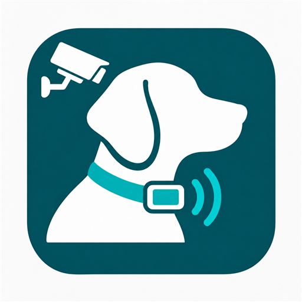

<p align="center"></p>

# Bark Alerts: Automatic RF Dog-Collar Beeps from Frigate Bark Detection

A Home Assistant integration that turns **Frigate dog-bark detections into
automatic beep-only RF commands for a compatible dog collar**, sent through
Broadlink. Choose one or more Frigate cameras, choose your Broadlink device,
and configure your own collar's learned beep command. No YAML or manual
entity-ID mapping is needed.

> [!WARNING]
> **An incorrectly learned or selected RF command could activate SHOCK instead
> of a beep. Read this before setup or testing.**
>
> Bark Alerts is intended for **beep-only use**. It cannot inspect an RF command
> and verify whether the collar will beep, vibrate, or deliver a shock. Naming a
> command `beep` or checking the beep-only confirmation does **not** make it safe.
> A wrong button, collar channel, saved command, or raw code can cause an
> unintended action, and automatic detections or configured repetitions can
> repeat that action.
>
> **Never learn, select, or automate shock or vibration commands. Remove the
> collar from the animal before learning or testing, and verify the actual
> response of the intended receiver before enabling automatic operation.**
> Recheck after relearning a command or changing the remote, receiver, channel,
> or configuration. Do not enable automation if the command's effect is uncertain.
>
> **Test beep (sends RF) transmits even with Armed off or Dry run on.** Those
> switches protect automatic operation; they do not block an explicit manual
> test. Disarming cannot cancel a command already sent or handed to Broadlink.
>
> Frigate can misclassify sounds and cannot establish which dog barked.
> Keep automatic operation disabled until you have checked detections in dry
> run, disable other automations targeting the collar, and supervise initial
> operation. Cooldowns are per entry, so multiple entries or other automations
> can produce additional commands.

This is an alerting companion, not a new audio classifier. Frigate performs the
audio/object detection; Bark Alerts connects those detections to an existing
Broadlink RF remote. No Frigate patches, cloud accounts, or copied household
configuration are required.

## Tested hardware and compatibility

The maintainer uses and has tested this integration with **one FunniPets
remote-controlled dog collar**, using its **beep command only**. The supplied
product listing describes the FunniPets two-collar set with beep, vibration,
and static-shock modes; **only one collar was used in integration testing**.

This is a limited compatibility report, not a guarantee for every FunniPets
model or hardware revision. Multi-collar operation, other collar models, and
shock/vibration operation have not been validated here. Shock and vibration
are outside this integration's intended use. A collar's brand or appearance
alone does not establish RF compatibility.

## Requirements

- Home Assistant **2026.10.2 or newer**.
- The [Frigate Home Assistant integration](https://github.com/blakeblackshear/frigate-hass-integration)
  configured with at least one individual camera. Modern registry identifiers
  are required; the source interface was reviewed against integration 5.15.6.
- [Frigate audio detection](https://docs.frigate.video/configuration/audio_detectors/)
  enabled for that camera, with `bark` in its listen labels. Its Home Assistant
  bark binary sensor must be enabled. Birdseye is not a supported source.
- An RF-capable device configured through Home Assistant's
  [Broadlink integration](https://www.home-assistant.io/integrations/broadlink/),
  exposing a remote and an RF transmitter. IR-only mini devices are not RF
  transmitters, even though they also have a remote entity.
- A compatible collar, its original remote, and your own learned beep command.
  Selecting a transmitter does not discover a collar or generate its RF code.
  RF band, encoding, and receiver compatibility still matter; not every collar
  can be controlled by Broadlink.

Optional animal-sound fallback additionally requires enabled `animal` audio and
`dog` occupancy sensors from **the same camera**.

## Install with HACS

Version **0.2.0** adds multi-camera monitoring, explicit dry-run notifications
and optional bark audio history. It retains typed command names and does not
read Broadlink's private storage. It includes the 0.1.1 `B1` packet fix.
See [CHANGELOG.md](CHANGELOG.md). After updating, restart Home Assistant and
reopen setup; an already-open flow uses old code.

1. Add `https://github.com/EndOfTheLine-HA/ha-bark-alerts` to HACS custom
   repositories, category **Integration**, and download **Bark Alerts**.
2. Restart Home Assistant.
3. Add **Bark Alerts** through **Settings → Devices & services**.
4. Choose your **Frigate cameras**, then your **Broadlink device**.
5. Choose a command source:
   - **Named command:** type the device/group name and beep command name exactly
     as they are saved in Home Assistant's Broadlink integration. For a new
     command, enter the names to use and press **Learn beep (receive RF)** on
     the new integration device afterward.
   - **Raw RF code:** the next screen shows only the private code field and
     beep-only confirmation. Paste your own captured Broadlink base64 RF packet.
     The optional `b64:` prefix is accepted. The field is masked; the code remains
     in your local HA config entry, not this repository.
6. Review the warning above and the default settings. The beep-only confirmation
   is your acknowledgement, not an automatic check of the RF command. Verify the
   receiver's actual response off the animal before enabling automatic operation.

The wizard does not send, learn, or physically test anything. Bark Alerts does
not inspect Broadlink's private storage or automatically list learned commands.
Enter the names exactly as Home Assistant knows them. Commands saved only in the
Broadlink app are not available to Home Assistant by name. A name does not prove
a command is RF-compatible or beep-only; verify its effect before confirming it.

## First use and controls

**Armed is the main on/off control.** Select one or more Frigate cameras in
setup or Reconfigure. Any selected camera can trigger the monitor; all share
one cooldown and one in-flight command limit. New cameras are never opted in
automatically. Sources ready means at least one selected camera and the remote
are available; an unavailable camera cannot trigger, and healthy cameras keep
working.

New entries start with **Armed off** and **Dry run off**. Every restart, reload,
options change or reconfiguration returns both switches to off. Arming is always
explicit and never replays old detections or sends a startup beep. With Dry run
off, arming permits automatic beep requests immediately on the next valid event.

**Dry run is optional testing mode.** Turn it on before arming to observe
detections without automatic RF transmissions. When Armed and Dry run are both
on, a persistent Home Assistant notification explains that automatic beeps are
blocked. This works in either switch order. Disarming, turning Dry run off, or
unloading the entry dismisses the notification. Dry run is never silently
disabled when arming. The explicit Test beep button still sends RF in dry run.

1. For a new named command, press **Learn beep (receive RF)** and follow the
   native Broadlink notifications. Press only the original remote's beep button.
   Learning the same device/group and command name again can overwrite that
   learned command. Use distinct names when appropriate.
2. The learning action may return without guaranteeing capture. Verify Broadlink
   notifications/logs and the learned result. Some RF devices have learning
   problems; privately captured raw RF codes are an alternative, not a guarantee
   of compatibility. No custom fixed-frequency capture tool is bundled.
3. With the collar **off the animal**, use **Test beep (sends RF)** only when
   ready for a physical test. This explicitly sends even while disarmed or in
   dry-run mode. It still respects cooldown and cannot queue a later test.
4. Turn **Dry run on**, then **Armed on** to observe detections without
   sending commands. The outcome sensor records what would happen.
5. Only after validating detection and the command, turn **Dry run off** to
   permit automatic beep requests. Disarm at any time to stop new requests.

Detection rules:

- Direct bark events use each selected camera's own bark sensor.
- Optional animal fallback requires a fresh dog occupancy transition from that
  camera in this HA session. A continuously present, freshly observed dog also
  qualifies. A dog seen by another camera never authorizes the fallback.
- Only `off` → `on` sensor transitions count. Initial states, retained `on`,
  recovery from `unknown`/`unavailable`, and attribute-only updates are ignored.
  A sensor must return to `off` before its next event can trigger.
- Default cooldown is 30 seconds, configurable from 5 to 3,600 seconds. Default
  repetitions are one, with a maximum of three. Dry runs use the same cooldown.
- Busy events are discarded. There is no delayed RF queue or automatic retry,
  including after a failed request or an integration unload.

The device exposes Armed, Dry run, Sources ready, Last outcome, Last detection,
Last command request, and the explicit test/learning buttons. Outcome counters
are session-only. `bark_alerts_alert` events contain only the entry ID, source
(`bark`, `animal`, or `manual`), and outcome, not command payloads.

Use **Configure** for cooldown/fallback/repetition settings. Use **Reconfigure**
to change the selected cameras, Broadlink device, or command. Multiple entries can
target one transmitter; cooldown is per entry, not global across entries or
other automations. Do not pair multiple noisy sources to one collar without
reviewing their combined behavior.

## Repetitions and troubleshooting

The default remains **one repetition** with a **one-second repetition delay**.
If a known beep command is received inconsistently, an optional setting is
**Beep command repetitions: 2** and **Delay between repetitions: 2 seconds**.
This requests two transmissions from Broadlink, so two audible beeps may be
expected. It is not a universal compatibility fix or a delivery guarantee.
Change one setting at a time and verify the effect with the collar **off the
animal**. Changing options reloads the entry and returns Armed and Dry run to off;
check the saved values before explicitly re-enabling automatic operation.

One alert increments `command_requests` once, even when that request includes
two or three repetitions. The counter does not measure RF packets or audible
beeps. Configured repetitions are distinct from an automatic retry after failure;
the integration does not add retries or queue a later alert.

When an expected beep is missing:

1. Check the actual **Armed** and **Dry run** switches first, especially after a
   restart, reload, options change, or reconfiguration. **Last outcome** describes
   the previous processed event; it can still say `disarmed` after you re-arm.
2. Check the selected camera's bark/animal source history and **Last detection**.
   A sound that remains `on` is not a new event: it must return to `off` and then
   turn `on` again. An animal-sound fallback also needs that camera's recently
   observed dog occupancy in the current session.
3. Check the recorded outcome. `dry_run`, `dog_not_recent`, `cooldown`, `busy`,
   `source_unavailable`, and `remote_unavailable` identify different gates;
   they are not confirmations of a transmitted command.
4. If the outcome is **Command requested: reception not confirmed**, the remote
   service returned without raising an error to Bark Alerts. Broadlink can log
   some transmission failures without raising them. Privately review its logs
   and check receiver power, range, and interference. Do not publish logs or
   traces that may contain private codes.
5. Verify the manual command off the animal, then separately verify a new natural
   detection. A manual test bypasses arming/dry-run and source gates; its success
   alone does not prove automatic detection, and dry-run success does not prove
   physical delivery. Keep any legacy automation disabled during the live check
   to avoid duplicate senders.

## Safety, privacy, and limitations

- **Beep only.** No shock/vibration features or example codes are provided.
  The integration cannot determine what an arbitrary user-supplied RF command
  actually does. Beep confirmation is not technical proof of the command's effect.
- Never rely on a sound classifier to identify which animal barked or to make
  welfare/safety decisions. Background audio and other animals can cause errors.
- A successful service return means **command requested**, not verified RF
  delivery or an audible beep. Broadlink may swallow some transmission errors;
  receiver sleep, range, batteries, and interference can prevent reception.
- Disarming/unloading cannot undo a radio command already requested/transmitted.
- RF codes are private control credentials, not encrypted secrets in HA backups.
  Keep backups, raw codes, home audio, entity registries, and household details
  private. Integration diagnostics omit commands, codes, names, and source IDs;
  Home Assistant/Broadlink logs and service traces may still contain them.
- Disable any existing bark-to-collar automation before arming this integration
  against the same equipment. No automatic migration or live deployment occurs.

## Bark audio history

Enable **Save the latest 25 bark audio clips** in Configure. It is off by
default. Listen in **Media > Bark Alerts history > your monitor**. Each bark
episode shows its timestamp, outcome and capture status. Saved bark clips
reports the playable count; Clear bark audio history deletes this monitor's
recordings and cancels pending captures without sending RF.

- Keeps the latest 25 bark episodes across all selected cameras, including
  while disarmed, in dry run, or in cooldown. Failed captures count toward the
  25-episode limit. It does not record manual tests or animal-sound fallback.
- Fetches about five seconds before and five seconds after the bark from the
  camera that triggered it, using existing Frigate recordings with audio.
  Segment alignment can affect the boundaries. Captures are available after
  roughly 20 seconds plus download/conversion time. FFmpeg is required.
- Reports missing recordings, audio, authentication or conversion as unavailable;
  these failures do not interrupt, retry, or queue collar commands.
- Stores mono 16 kHz WAV audio in the integration's own
  `/config/.storage/bark_alerts_history/<entry_id>/` folder, outside public `www`.
  It never reads Broadlink's private storage. Audio survives restarts; interrupted
  captures are marked and are not retried. Turning capture off keeps old clips.
- Playback requires HA authentication or a temporary signed media URL. Each
  clip is at most 400 KB (about 10 MB per monitor); temporary video downloads
  are capped at 20 MiB and deleted after processing. Recordings may contain
  private household conversations and may be included in backups. Do not publish
  recordings or share their playback URLs.

Frigate connection settings and authentication are reused from the triggering
camera's integration. This compatibility adapter depends on Frigate's runtime
client interface and reports unavailable capture if that interface changes.
It does not change Frigate recording or retention settings.

## Upgrading from separate camera monitors

Existing entries and entity IDs are preserved and start disarmed after the
upgrade. To combine monitors for one collar, disarm the old entries, use
Reconfigure on one entry to select all desired cameras, and disable the other
entries in HA. Their stored histories remain separate; no recordings or entries
are automatically deleted or combined. One multi-camera monitor provides the
shared cooldown. Separate entries and external automations have independent
cooldowns, so avoid arming duplicates that target the same collar.

## Development and verification

```sh
uvx ruff check .
uvx ruff format --check .
uv run --python 3.14 --with homeassistant==2026.10.2 --with pytest --with pytest-asyncio --with imageio-ffmpeg python -m pytest -q
```

Tests use isolated Home Assistant registries/state events and mocked remote
services. No real transmitter is contacted. GitHub workflows are included for
pytest, Ruff, HACS, and Hassfest. See the latest commit's Actions results and
[AUDIT.md](AUDIT.md) for the verification boundary.

The original community icon source is `custom_components/bark_alerts/brand/icon.svg`.
Its 256/512-pixel PNG renders are included for HACS branding; it is not an
official manufacturer logo.

MIT licensed; community software, not affiliated with Frigate, Broadlink, or any
collar manufacturer. HACS custom-repository installation and default-catalog
inclusion are separate publication stages.
